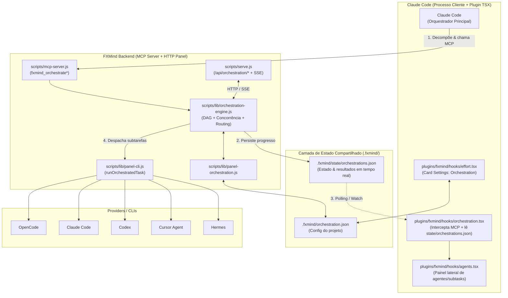

# Plano de Implementação: Orquestração Multi-Agente no FXMind

> **Status do Documento:** Planejamento continuado e consolidado após auditoria do código já iniciado no repositório (`scripts/lib/panel-orchestration.js` e `scripts/lib/orchestration-engine.js`).
> **Objetivo:** Permitir que o **Claude Code** atue como orquestrador principal — decompondo demandas complexas em subtarefas com dependências (DAG) — enquanto o **FXMind** gerencia roteamento, concorrência, aprovação, streaming de progresso e execução multi-provider (**OpenCode**, **Claude Code**, **Codex**, **Cursor Agent**, **Hermes** e provedores BYOK).

---

## 1. Diagnóstico do Estado Atual (O que já existe vs. Gaps encontrados)

### 1.1 Arquivos já criados (não commitados)
1. **`scripts/lib/panel-orchestration.js`** (Concluído — base funcional)
   - Define `DEFAULT_ORCHESTRATION` (`enabled`, `mode`, `strategy`, `maxConcurrent`, `routing.rules`, `allowedProviders`, `autoOpenBrowser`).
   - Implementa merge hierárquico (`DEFAULT_ORCHESTRATION` → `~/.fxmind/panel.json` → `.fxmind/orchestration.json`).
   - Expõe `readOrchestrationConfig`, `writeOrchestrationConfig`, `getOrchestrationSettings`, `putOrchestrationSettings`.
2. **`scripts/lib/orchestration-engine.js`** (Criado — requer ajustes de integração antes de conectar ao MCP/UI)
   - Implementa `OrchestrationEngine` com `startOrchestration`, `pump`, `dispatchSubtask`, `buildSubtaskPrompt`, `cancelOrchestration`, `subscribe`, `subscribeAll` e persistência em `.fxmind/state/orchestrations.json`.

### 1.2 Gaps Técnicos Identificados na Auditoria
Antes de avançar para MCP, HTTP e UI, os seguintes pontos precisam ser corrigidos nos módulos já criados:

| # | Severidade | Arquivo | Problema Identificado | Correção Planejada |
|---|---|---|---|---|
| 1 | **Alta** | `scripts/lib/orchestration-engine.js` (`executeCliTask`) | Chama `panelCli.runSubagentTask(root, { cliId, model, prompt, task, effort })`, mas em `scripts/lib/panel-cli.js:1912` a assinatura real é `runSubagentTask(root, { agent, preferredCliId, prompt, files })` e ela ignora `cliId` quando `agent !== "reviewer"`. | Criar `runOrchestratedTask(root, { cliId, model, effort, prompt, readOnly })` em `panel-cli.js` (reaproveitando `CLI_CATALOG`, `resolveBin`, `providerEnv` e timeout/stream) ou estender `runSubagentTask` para aceitar override explícito de `cliId`/`model`/`effort`. |
| 2 | **Alta** | `scripts/lib/orchestration-engine.js` (`startOrchestration`) | Não valida ciclos no grafo de dependências (`dependsOn`) nem referências a IDs inexistentes. Um ciclo (ex.: `st_1` ↔ `st_2`) deixa subtarefas presas em `pending` para sempre. | Adicionar validação topológica (DFS / Kahn) em `validatePlan(subtasks)` antes de criar a sessão, retornando `{ ok: false, error }` em caso de ciclo ou dependência desconhecida. |
| 3 | **Média** | `scripts/lib/orchestration-engine.js` (`startOrchestration`) | O modo `mode: "confirm"` existe na configuração (`panel-orchestration.js`), mas `startOrchestration` sempre inicia em `status: "running"` e dispara `pump()` imediatamente. | Quando `config.mode === "confirm"` e `!options.approved`, criar sessão com `status: "awaiting_approval"` sem disparar `pump()`, expondo `approveOrchestration(id)` para iniciar a execução após confirmação. |
| 4 | **Média** | `scripts/lib/orchestration-engine.js` (`pump` & `resolveSubtaskRouting`) | `strategy: "sequential"` é salvo na sessão mas ignorado no `pump()`, e `config.allowedProviders` não é verificado ao resolver o provider. | Forçar `effectiveConcurrency = session.strategy === "sequential" ? 1 : session.maxConcurrent` no `pump()` e validar `allowedProviders` em `resolveSubtaskRouting` (com fallback para `defaultProvider` ou erro claro). |
| 5 | **Média** | `plugins/fxmind/hooks/orchestration.tsx` (Arquitetura IPC) | O plugin Claude Code roda no processo da CLI do Claude, enquanto o MCP server (`mcp-server.js`) e o painel (`serve.js`) rodam em processos separados. Eventos em memória (`EventEmitter`) no `orchestration-engine.js` não cruzam processos sozinhos. | Persistir cada transição de estado em `.fxmind/state/orchestrations.json` (já feito) **e** fazer o hook `orchestration.tsx` ler/observar esse arquivo de estado (além de interceptar `tool.start` / `tool.end` das tools `mcp__fxmind__fxmind_orchestrate*`). |
| 6 | **Baixa** | `scripts/lib/layout.js` | `PROJECT_GITIGNORE_LINES` ignora `.fxmind/*` exceto pastas explicitamente listadas (`memory/`, `corrections/`, etc.). | Decidir e registrar `!.fxmind/orchestration.json` em `layout.js` (`PROJECT_GITIGNORE_LINES` e `sharedFxmindFile`) caso a configuração por projeto deva ser compartilhada no Git da equipe. |

---

## 2. Arquitetura Consolidada



---

## 3. Plano de Execução por Fases

### Fase 1 — Fundação de Configuração e Motor (Em andamento — 80% concluída)
- [x] Criar `scripts/lib/panel-orchestration.js`
- [x] Criar `scripts/lib/orchestration-engine.js`
- [ ] **Aplicar correções da auditoria (Seção 1.2):**
  1. Adicionar `runOrchestratedTask(root, options)` em `scripts/lib/panel-cli.js` suportando `cliId`, `model`, `effort`, `prompt`, `readOnly` e `signal` (para cancelamento real de subprocessos ativos).
  2. Atualizar `executeCliTask` em `scripts/lib/orchestration-engine.js` para usar `panelCli.runOrchestratedTask`.
  3. Adicionar validação de DAG (`validateDag`) em `orchestration-engine.js` (detectando ciclos e `dependsOn` inválidos).
  4. Implementar `mode: "confirm"` (`status: "awaiting_approval"` + método `approveOrchestration(id)`).
  5. Respeitar `strategy: "sequential"` (`concurrency = 1`) e `allowedProviders`.
  6. Atualizar `scripts/lib/layout.js` para incluir `!.fxmind/orchestration.json` na política de arquivos compartilhados do projeto.

---

### Fase 2 — Ferramentas MCP (`scripts/mcp-server.js`)

Registrar 4 ferramentas MCP no `TOOLS` de `scripts/mcp-server.js` e tratá-las em `dispatchTool`:

1. **`fxmind_orchestrate`**
   - **Descrição:** Recebe uma tarefa principal e a lista de subtarefas decompostas pelo Claude Code (com `id`, `description`, `type`, `provider`, `model`, `effort`, `dependsOn`, `readOnly`), inicia a orquestração e opcionalmente aguarda conclusão (`wait: boolean`, `timeoutMs: number`).
   - **Input Schema:**
     ```json
     {
       "type": "object",
       "properties": {
         "task": { "type": "string", "description": "Objetivo geral da orquestração." },
         "strategy": { "type": "string", "enum": ["smart", "parallel", "sequential"] },
         "wait": { "type": "boolean", "description": "Se true (padrão), aguarda conclusão antes de retornar resultados consolidados." },
         "timeoutMs": { "type": "number", "description": "Timeout máximo de espera em ms (padrão: 300000)." },
         "subtasks": {
           "type": "array",
           "items": {
             "type": "object",
             "properties": {
               "id": { "type": "string" },
               "description": { "type": "string" },
               "type": { "type": "string", "enum": ["explore", "implement", "review", "test", "query"] },
               "provider": { "type": "string" },
               "model": { "type": "string" },
               "effort": { "type": "string", "enum": ["low", "medium", "high", "max"] },
               "dependsOn": { "type": "array", "items": { "type": "string" } },
               "readOnly": { "type": "boolean" }
             },
             "required": ["id", "description"]
           }
         }
       },
       "required": ["task", "subtasks"]
     }
     ```
2. **`fxmind_orchestration_status`**
   - **Descrição:** Consulta o estado atual de uma orquestração específica (`orchestrationId`) ou da sessão ativa/mais recente do projeto, retornando progresso percentual, status de cada subtarefa e saídas parciais.
3. **`fxmind_orchestration_control`**
   - **Descrição:** Permite aprovar (`action: "approve"`) uma orquestração em `awaiting_approval` ou cancelar (`action: "cancel"`) uma orquestração em execução.
4. **`fxmind_orchestration_config`**
   - **Descrição:** Lê (`action: "get"`) ou atualiza (`action: "set"`) as configurações de orquestração (`scope: "project" | "global"`).

> **Nota sobre modo Read-Only (`mcp-readonly.test.js`):** Garantir que apenas `fxmind_orchestration_status` e `fxmind_orchestration_config` (com `action: "get"`) fiquem expostas se o servidor MCP iniciar em modo `--readonly`.

---

### Fase 3 — API HTTP & Streaming SSE (`scripts/serve.js`)

Adicionar endpoints REST e SSE em `scripts/serve.js` para permitir controle e acompanhamento tanto pelo painel web quanto pelo plugin:

| Método | Rota | Descrição |
|---|---|---|
| `GET` | `/api/orchestration/config` | Lê configuração efetiva (`?projectId=...` ou `?root=...`) + flag `hasProjectConfig`. |
| `PUT` | `/api/orchestration/config` | Salva configuração (`scope: "project" \| "global"`). |
| `POST` | `/api/orchestration/run` | Inicia uma nova orquestração a partir de `{ task, subtasks, strategy, root }`. |
| `POST` | `/api/orchestration/:id/approve` | Aprova uma orquestração em `awaiting_approval`. |
| `POST` | `/api/orchestration/:id/cancel` | Cancela uma orquestração em andamento e encerra subtarefas pendentes. |
| `GET` | `/api/orchestration/active` | Retorna o snapshot da orquestração ativa ou mais recente. |
| `GET` | `/api/orchestration/history` | Lista histórico das últimas 20 orquestrações persistidas. |
| `GET` | `/api/orchestration/:id` | Retorna detalhes completos e resultados de uma orquestração. |
| `GET` | `/api/orchestration/stream` | Stream **SSE** (`text/event-stream`) transmitindo eventos `orchestration_started`, `subtask_updated`, `orchestration_finished` e `orchestration_cancelled`. |

---

### Fase 4 — Plugin Claude Code: Hooks, Painel Lateral e Settings (`plugins/fxmind/`)

#### 4.1 Tipagem (`plugins/fxmind/types/index.d.ts`)
- Adicionar `OrchestrationSubtask` e `OrchestrationSession` em `types/index.d.ts`.
- Estender `PluginState['fxmind']` com `orchestration: OrchestrationSession | null`.
- Estender `SettingsCard` para incluir `'orchestration'`.

#### 4.2 Módulo de Hooks (`plugins/fxmind/hooks/orchestration.tsx`)
- Criar `registerOrchestration(on, options)`:
  - **Sincronização de Estado Multi-Processo:** Ler `.fxmind/state/orchestrations.json` nos ciclos de `ui.render` / `tool.start` / `tool.end` (com cache por `mtimeMs` para custo zero de I/O quando não houver mudança) e atualizar o atom `orchestration`.
  - **Interceptação MCP:** Detectar chamadas a `mcp__fxmind__fxmind_orchestrate`, `mcp__fxmind__fxmind_orchestration_status` e `mcp__fxmind__fxmind_orchestration_control` para abrir automaticamente o painel lateral (`AGENTS_PANE`) quando uma orquestração iniciar.
  - **Banner de Aprovação (Modo `confirm`):** Quando `orchestration.status === 'awaiting_approval'`, exibir barra de confirmação acima do prompt com botões **Aprovar e Executar** / **Cancelar**.

#### 4.3 Integração no Painel Lateral (`plugins/fxmind/hooks/agents.tsx`)
- Exibir seção/cards dedicados às subtarefas da orquestração ativa dentro de `AGENTS_PANE`:
  - Badge do provider/CLI (`opencode`, `codex`, `claude`, `cursor`, `hermes`) + modelo + nível de `effort`.
  - Indicador de dependências (`dependsOn`), tempo decorrido (`clockText`) e status (`pending`, `running`, `done`, `failed`, `cancelled`).
  - Barra de progresso consolidada combinando subagentes nativos do Claude e subtarefas externas do FXMind.

#### 4.4 Card de Configurações (`plugins/fxmind/hooks/effort.tsx`) e Registro (`register.tsx`)
- Adicionar `{ id: 'orchestration', title: 'Orchestration' }` em `CARDS` (`effort.tsx`).
- Renderizar controles para:
  - Ativar/Desativar orquestração (`enabled`)
  - Modo de execução (`auto` / `confirm` / `off`)
  - Estratégia padrão (`smart` / `parallel` / `sequential`)
  - Concorrência máxima (`1` a `10`)
  - Visualização/edição das regras de roteamento (`explore`, `review`, `implement`, `test`, `query`)
- Registrar `registerOrchestration(on, options)` em `plugins/fxmind/hooks/register.tsx`.

---

### Fase 5 — Templates, Documentação e Sincronização de Skills

1. **Template de Configuração:**
   - Criar `templates/fxmind/orchestration.json` com a configuração padrão comentada/estruturada para projetos que rodarem `fxmind init` / `fxmind --update`.
2. **Instruções para o Agente (`SKILL.md`):**
   - Atualizar **`plugins/fxmind/skills/fxmind/SKILL.md`** e **`skills/fxmind/SKILL.md`** (mantendo ambos sincronizados) com a seção **Agent Orchestration**:
     - Quando decompor tarefas com `fxmind_orchestrate` vs. executar diretamente.
     - Como estruturar `dependsOn` para pipelines (ex.: `explore` → `implement` → `review`/`test`).
     - Como respeitar `fxmind_claim_paths` para evitar conflito de escrita entre subtarefas paralelas (subtarefas paralelas que editam arquivos devem atuar em arquivos disjuntos; caso contrário, declarar `dependsOn`).

---

## 4. Plano de Verificação e Testes

### 4.1 Testes Unitários e de Integração
1. **`scripts/lib/panel-orchestration.test.js`**
   - Merge de configuração padrão + global (`panel.json`) + projeto (`.fxmind/orchestration.json`).
   - Persistência isolada por escopo (`project` vs `global`).
2. **`scripts/lib/orchestration-engine.test.js`**
   - Execução paralela respeitando `maxConcurrent` (ex.: 5 subtarefas com `maxConcurrent = 2` nunca ultrapassam 2 simultâneas).
   - Execução DAG respeitando `dependsOn` e propagação de contexto (`buildSubtaskPrompt` inclui saída das dependências).
   - Cancelamento em cascata quando uma dependência falha (`status: "cancelled"`).
   - Rejeição imediata de planos com ciclo no DAG (`A -> B -> A`).
   - Modo `confirm` iniciando em `awaiting_approval` e avançando somente após `approveOrchestration()`.
   - Roteamento por regra (`explore` → `opencode`, `review` → `claude`, `implement` → `codex`) e respeito a `allowedProviders`.
3. **Testes de Regressão Existentes**
   - Executar `npm test` completo, incluindo `scripts/mcp-readonly.test.js`, `scripts/lib/project-gitignore.test.js` e `plugins/fxmind/hooks/effort.test.ts`.

### 4.2 Validação Manual End-to-End
1. Abrir Settings no Claude Code → aba **Orchestration** → alterar modo/estratégia/concorrência e confirmar gravação em `.fxmind/orchestration.json`.
2. Solicitar uma tarefa multi-etapa no Claude Code (ex.: explorar módulo + implementar alteração + revisar) e verificar:
   - Chamada à tool `fxmind_orchestrate`.
   - Atualização em tempo real no painel lateral (`AGENTS_PANE`) e no painel web (`GET /api/orchestration/stream`).
   - Consolidação final da resposta pelo Claude Code.

---

## 5. Checklist de Arquivos (Mapa Completo)

| Status | Caminho | Responsabilidade |
|---|---|---|
| Criado | `scripts/lib/panel-orchestration.js` | Leitura/escrita hierárquica da config de orquestração |
| Criado (ajustar) | `scripts/lib/orchestration-engine.js` | Motor DAG, fila com concorrência, aprovação, persistência e eventos |
| Pendente | `scripts/lib/panel-cli.js` | Adicionar `runOrchestratedTask` com suporte a `cliId`, `model`, `effort` |
| Pendente | `scripts/lib/layout.js` | Whitelist de `!.fxmind/orchestration.json` no `.gitignore` gerenciado |
| Pendente | `scripts/mcp-server.js` | Tools `fxmind_orchestrate`, `fxmind_orchestration_status`, `fxmind_orchestration_control`, `fxmind_orchestration_config` |
| Pendente | `scripts/serve.js` | Endpoints REST `/api/orchestration/*` + stream SSE |
| Pendente | `plugins/fxmind/types/index.d.ts` | Tipos TS da orquestração e do card de settings |
| Pendente | `plugins/fxmind/hooks/orchestration.tsx` | Hook de sincronização de estado, interceptação MCP e barra de aprovação |
| Pendente | `plugins/fxmind/hooks/agents.tsx` | Renderização das subtarefas orquestradas no painel lateral |
| Pendente | `plugins/fxmind/hooks/effort.tsx` | Card `Orchestration` no painel de Settings |
| Pendente | `plugins/fxmind/hooks/register.tsx` | Registro do módulo `orchestration.tsx` |
| Pendente | `plugins/fxmind/skills/fxmind/SKILL.md` | Documentação operacional de orquestração para o agente |
| Pendente | `skills/fxmind/SKILL.md` | Espelho sincronizado da skill principal |
| Pendente | `templates/fxmind/orchestration.json` | Template inicial criado em novos projetos |
| Pendente | `scripts/lib/panel-orchestration.test.js` | Testes unitários da camada de configuração |
| Pendente | `scripts/lib/orchestration-engine.test.js` | Testes unitários do motor DAG, concorrência, aprovação e routing |
